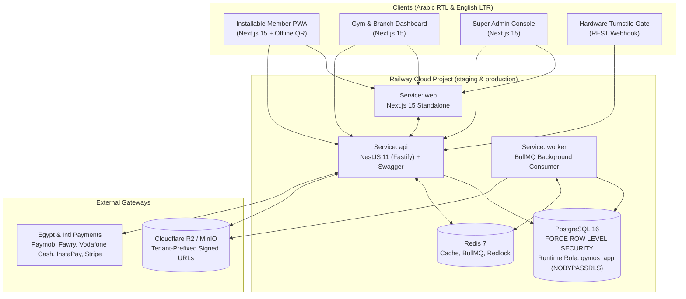

# TitanFit (Rooted Performance) — System Architecture (`ARCHITECTURE.md`)

## 1. Modular Monolith & Railway Topology

## 2. Isolated Domain Modules

1. **`Auth & Sessions`**: Memory-hard `scrypt` password hashing, short-lived HS256 JWT access tokens, rotating refresh token families with automatic reuse detection, 6-digit OTP challenges, RFC 6238 TOTP 2FA, and progressive brute-force lockout.
2. **`Tenants & RBAC`**: Permission-based `@RequirePermissions(...)` guards (`DEFAULT_ROLE_PERMISSIONS`), multi-branch scoping, and audited Super Admin impersonation.
3. **`Members & Billing`**: Member profiles, AES-256-GCM field-level health encryption bound to `tenantId` AAD, subscription plans, freeze/unfreeze date extension math, coupon discounts, 14% Egypt VAT calculation, idempotency-key deduplication, and signed QR tax invoices.
4. **`Classes & Access Control`**: Concurrency-safe class bookings, late-cancellation window penalties, automatic waitlist promotion, and 30-second rotating HMAC-SHA256 QR check-in with 15-minute anti-passback cooldown and hardware turnstile relay pulse.
5. **`Fitness, POS & Analytics`**: Workout logger with Epley 1RM Personal Record auto-detection, BMI body measurements, daily macro tracker, RFC 5545 `.ics` calendar export, POS inventory sales, gamification streaks/leaderboards, trainer-member chat, and CSV financial export.
