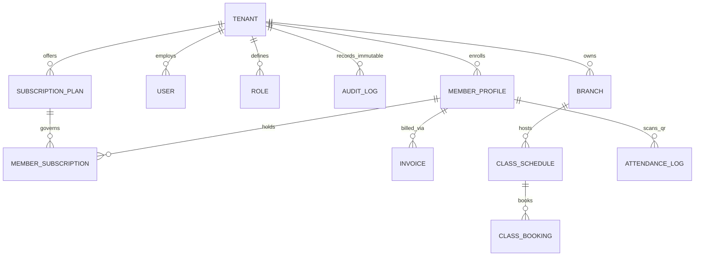

# TitanFit — Database Schema & Non-Bypassable RLS (`DATABASE.md`)

## 1. Entity-Relationship Diagram (ERD)



## 2. Three-Layer Multi-Tenant Isolation & Railway Role Separation

1. **Migration Role (`gymos_owner`)**: Used exclusively during `prisma migrate deploy` (`DATABASE_MIGRATION_URL`).
2. **Runtime API Role (`gymos_app`)**: Provisioned with `LOGIN NOSUPERUSER NOCREATEDB NOCREATEROLE NOINHERIT NOBYPASSRLS`.
3. **Forced Row-Level Security (`FORCE ROW LEVEL SECURITY`)**: Every tenant-owned table enforces:
   ```sql
   USING (tenant_id = current_app_tenant_id() OR is_app_super_admin())
   WITH CHECK (tenant_id = current_app_tenant_id() OR is_app_super_admin())
   ```
4. **Immutable Audit Logs (`audit_logs`)**: Protected by PostgreSQL trigger `trg_audit_logs_immutable` which raises an exception on any `UPDATE` or `DELETE` statement.
